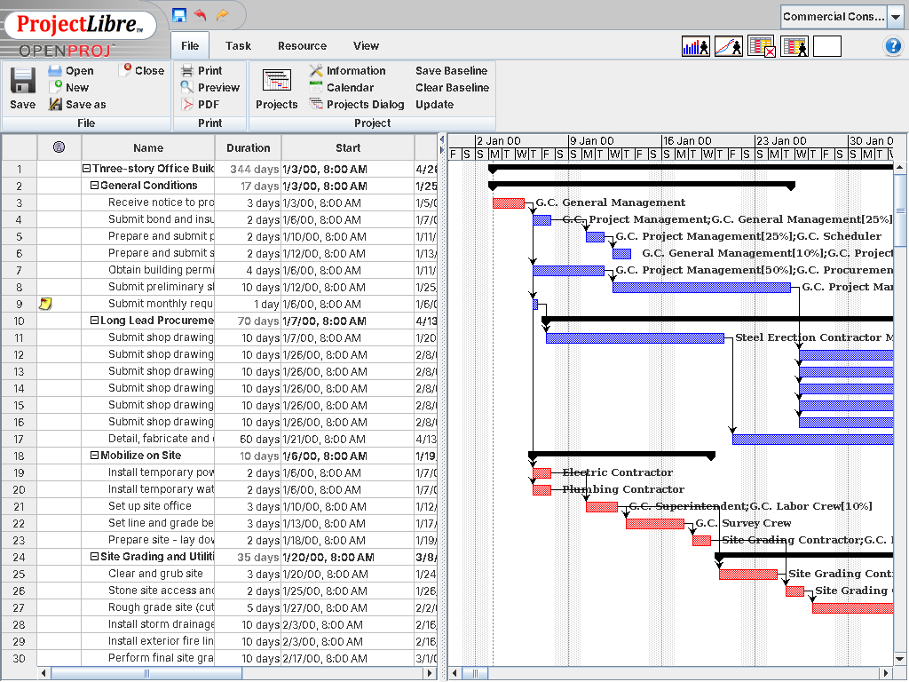
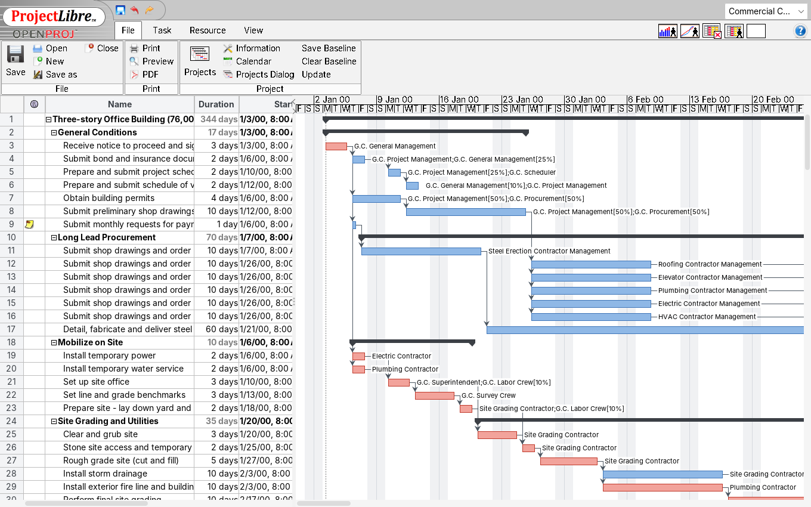

# projectlibre

The Open Source replacement of Microsoft Project

> **This fork: UI/UX refresh.** A modern, Microsoft Project-style look
> (FlatLaf theme, soft Gantt bars, antialiased chart, today line, sensible
> window and column sizes). It builds and runs on current Java (11-21).
> See [DEVELOPMENT.md](DEVELOPMENT.md) to build it and
> [docs/ui-ux/](docs/ui-ux/ROADMAP.md) for the research and roadmap.
>
> | Before | After |
> |---|---|
> |  |  |
>
> Quick start: `scripts/setup-dev.sh && scripts/build.sh && scripts/run.sh`.
> Add `-Dprojectlibre.laf=classic` (e.g. `scripts/run.sh "" -Dprojectlibre.laf=classic`)
> for the original Swing widgets.

Features
--------

* Microsoft Project replacement
* Gantt Chart
* New and updated version of OpenProj with hundreds of updates/bug fixes
* Earned Value Costing
* PERT Charts
* Project Management software
* RBS Chart
* New version of OpenProj

Follow @projectlibre
